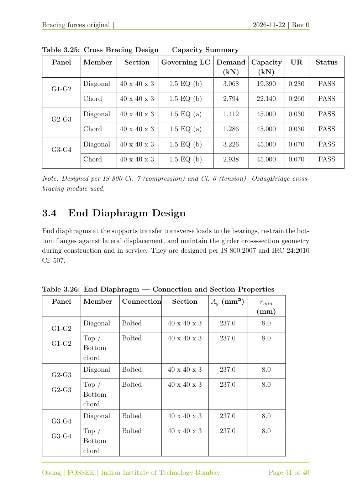
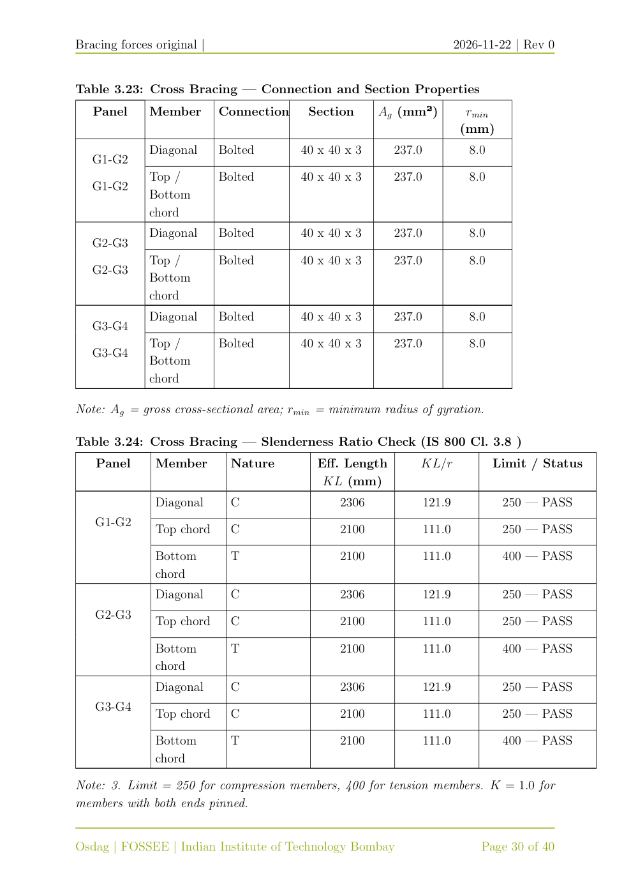

# OsdagBridge — Software Testing Report

Independent testing of the **short-span steel plate girder bridge module** of [OsdagBridge](https://github.com/Nidhikhare12/OsdagBridge) (branch `dev`, commit `d74f56d`), carried out for the FOSSEE Winter Internship screening task (IIT Bombay).

> The OsdagBridge source was treated as **read-only**. Every script, input, log, screenshot and generated report that supports a finding is stored in this repository. Proposed fixes were proven by monkeypatching a copy of the affected function inside the tests.

## Quick links

| Document | Description |
|---|---|
| [**report/report.pdf**](report/report.pdf) | Full testing report (PDF, v2.1, 22 Nov 2026) |
| [proofs/](proofs/) | One folder per issue: reproduction command, expected vs. actual, logs, screenshots, generated reports |
| [test_log.md](test_log.md) | Every executed test: ID, exact parameters, expected, actual, result, evidence |
| [notes/BUG_REPORT.md](notes/BUG_REPORT.md) | Working bug report with tiers and candidate status |
| [notes/issue_drafts/](notes/issue_drafts/) | Issue and comment texts as drafted |

## At a glance

| Metric | Value |
|---|---|
| Issues filed upstream | **28** |
| Filed on 22 Nov 2026 | 5 (#211 – #213, #215, #216), all T1; #211 is **S1**, #215 is an S1 candidate |
| Filed on 21 Nov 2026 | 5 (#206 – #210), all T1 (reproduced twice, fix proven) |
| Root-cause analyses contributed to existing issues | 7 (incl. #135, #88, #20, #19, #42) |
| Automated extreme-value cases (validators, layout, loader) | 1,966 executed, all oracles satisfied |
| Upstream issues screened for duplicates | all issues (open and closed) before each filing; 4 more leads found to be duplicates (#113, #148, #141/#86, #43) |

## Issues filed

**Tier:** T1 confirmed (2 fresh-process reproductions) · T2 likely · T3 static · T5 install · T6 docs · T7 maybe intended  
**Severity:** S1 wrong engineering result / security · S2 crash or wrong behaviour with workaround · S3 cosmetic / low impact

### Filed 22 November 2026

| Issue | Title | Category | Tier | Sev. | State | Proof |
|---|---|---|---|---|---|---|
| [#211](https://github.com/Nidhikhare12/OsdagBridge/issues/211) | [Bug/Analysis] Design live load is taken from static vehicles parked at x = 0, never at the critical position — girder live-load moment underestimated (≈ 14 % lower ULS moment on a 40 m span) | Analysis | T1 | **S1** | open | [`proofs/211_static_vehicles_fixed_at_x0`](proofs/211_static_vehicles_fixed_at_x0/) |
| [#212](https://github.com/Nidhikhare12/OsdagBridge/issues/212) | [Bug/Report] generate_report returns an older PDF as the new report when compilation fails (success is judged only by "a file with that name exists") | Report | T1 | S2 | open | [`proofs/212_stale_pdf_returned_as_success`](proofs/212_stale_pdf_returned_as_success/) |
| [#215](https://github.com/Nidhikhare12/OsdagBridge/issues/215) | [Bug/Design] Cross-bracing design forces are read from the horizontal force Vz, so every gravity load (DL, LL) contributes 0 — bracing is sized for 1–3 kN of seismic/wind only | Design | T1 | **S1?** | open | [`proofs/215_bracing_forces_ignore_gravity_loads`](proofs/215_bracing_forces_ignore_gravity_loads/) |
| [#216](https://github.com/Nidhikhare12/OsdagBridge/issues/216) | [Bug/Report] Cross-bracing report tables contradict themselves: KL/r is not KL ÷ r_min (2306 / 8.0 = 288 > 250 printed as 121.9 PASS) and UR is not Demand ÷ Capacity | Report | T1 | S2 | open | [`proofs/216_bracing_report_tables_contradict`](proofs/216_bracing_report_tables_contradict/) |
| [#213](https://github.com/Nidhikhare12/OsdagBridge/issues/213) | [Bug/Design] Bearing-zone web buckling check (Cl. 509.7.3.1) reports a capacity 69× the squash load — uses the stiffener's inertia and an uncapped Euler stress, so it always passes | Design check | T1 | S2 | open | [`proofs/213_web_buckling_exceeds_squash_load`](proofs/213_web_buckling_exceeds_squash_load/) |

**Screenshots of #215 / #216** (pages of OsdagBridge's own generated report):

| #215: all governing cases are seismic, 1–3 kN | #216: KL/r and UR contradict the printed columns |
|---|---|
|  |  |

How these were found: a hand moving-load calculation and a span metamorphic test (20 → 30 → 40 m must not reduce the live-load moment) for #211; a fault-injection test (LaTeX unavailable) for #212; a physics oracle (no compressive capacity may exceed the squash load A·fy/γm0) for #213; a load-path check (do gravity loads reach the cross-bracing design?) and a fix-proof monkeypatch for #215; an arithmetic oracle on the printed tables (KL/r = KL ÷ r, UR = D ÷ C) for #216.

### Filed 21 November 2026

| Issue | Title | Category | Tier | Sev. | State | Proof |
|---|---|---|---|---|---|---|
| [#206](https://github.com/Nidhikhare12/OsdagBridge/issues/206) | [Bug/Validation] Clearing the Skew Angle field silently sets skew to -15° instead of the default 0° | Validation / UI | T1 | S2 | open | [`proofs/206_empty_skew_resets_to_minus15`](proofs/206_empty_skew_resets_to_minus15/) |
| [#207](https://github.com/Nidhikhare12/OsdagBridge/issues/207) | [Bug/Validation] Carriageway width validator treats Median = "No" as a median, suggesting 7.5 m instead of 4.25 m | Validation | T1 | S2 | open | [`proofs/207_median_no_treated_as_yes`](proofs/207_median_no_treated_as_yes/) |
| [#208](https://github.com/Nidhikhare12/OsdagBridge/issues/208) | [Bug/Report] Design log warnings and errors are never written to the PDF report — ch8_design_log discards log_entries | Report | T1 | S2 | open | [`proofs/208_design_log_dropped_from_report`](proofs/208_design_log_dropped_from_report/) |
| [#209](https://github.com/Nidhikhare12/OsdagBridge/issues/209) | [Bug/Robustness] PlateGirderBridge._lookup_material returns None for an unknown grade and raises IndexError for an empty name | Robustness | T1 | S3 | open | [`proofs/209_lookup_material_returns_none`](proofs/209_lookup_material_returns_none/) |
| [#210](https://github.com/Nidhikhare12/OsdagBridge/issues/210) | [Bug/Report] _tex() double-escapes backslashes, so "\" in report text is printed as "\{}" | Report | T1 | S3 | open | [`proofs/210_tex_backslash_double_escape`](proofs/210_tex_backslash_double_escape/) |

### Filed 15 – 18 November 2026

| Issue | Title | Category | Tier | Sev. | State | Proof |
|---|---|---|---|---|---|---|
| [#96](https://github.com/Nidhikhare12/OsdagBridge/issues/96) | [Bug] Loading a .osi file skips all custom-material validation — out-of-range material values load unchallenged | Validation | T1 | S2 | open | see report §9 |
| [#97](https://github.com/Nidhikhare12/OsdagBridge/issues/97) | [Bug] Toggling input lock can crash when Additional Inputs dialog was never opened (`_additional_inputs_dialog` is None) | UI state | T3 | S2 | open | see report §9 |
| [#98](https://github.com/Nidhikhare12/OsdagBridge/issues/98) | [Bug/Install] `osdag_core` dependency metadata declares bogus `sqlite` package (breaks clean dependency resolution) | Install | T5 | S2 | open | see report §9 |
| [#99](https://github.com/Nidhikhare12/OsdagBridge/issues/99) | [Bug/Install] `pyproject.toml` runtime dependencies omit required packages and declare unused `pydantic` | Install | T5 | S2 | open | see report §9 |
| [#100](https://github.com/Nidhikhare12/OsdagBridge/issues/100) | [Docs/Packaging] Inconsistent dependency declarations across `pyproject.toml`, `requirements.txt`, and `environment.yml` | Packaging | T6 | S3 | open | see report §9 |
| [#101](https://github.com/Nidhikhare12/OsdagBridge/issues/101) | [Docs/CLI] README documents CLI usage but installed CLI entrypoint is a stub that ignores arguments | Docs / CLI | T6 | S3 | open | see report §9 |
| [#127](https://github.com/Nidhikhare12/OsdagBridge/issues/127) | [Docs/Examples] `verification_case_01.yaml` and `verification_case_02.yaml` are empty placeholders that fail OSI validation | Docs | T6 | S3 | open | see report §9 |
| [#128](https://github.com/Nidhikhare12/OsdagBridge/issues/128) | [Docs/Examples] `example_basic.yaml` uses placeholder keys but passes `validate_osi_inputs` vacuously | Docs | T7 | S3 | open | see report §9 |
| [#129](https://github.com/Nidhikhare12/OsdagBridge/issues/129) | [Bug/Validation] `validate_material_inputs` skips range checks for cross-bracing/end-diaphragm material keys | Validation | T2 | S2 | open | see report §9 |
| [#130](https://github.com/Nidhikhare12/OsdagBridge/issues/130) | [Bug/Validation] Integer validators raise `OverflowError` on `inf`/`-inf` instead of returning a validation message | Validation | T2 | S2 | open | see report §9 |
| [#131](https://github.com/Nidhikhare12/OsdagBridge/issues/131) | [Bug/I-O] `saveOSI_inputs` uses `yaml.dump` (unsafe tags) while load uses `yaml.safe_load` — round-trip can fail | File I/O | T2 | S2 | open | see report §9 |
| [#132](https://github.com/Nidhikhare12/OsdagBridge/issues/132) | [Bug/Analysis] Skew sign is not mirror-symmetric: +15° and −15° give different design demands for a symmetric bridge | Analysis | T2 | S1 | open | see report §9 |
| [#133](https://github.com/Nidhikhare12/OsdagBridge/issues/133) | [Bug/Performance] Valid inputs (span 45 m + median + footpaths) make `design()` run >10 minutes without completing | Performance | T2 | S2 | open | see report §9 |
| [#134](https://github.com/Nidhikhare12/OsdagBridge/issues/134) | [Bug/Analysis] Valid input silently skips live load → all design demands = 0 and verdict PASS (wrong PASS) | Analysis | T1 | S1 | open | see report §9 |
| [#135](https://github.com/Nidhikhare12/OsdagBridge/issues/135) | [Bug/Crash] Second `design()` call on the same object crashes in LTB buckling check (`math domain error`) | Crash / state | T1 | S2 | open | see report §9 |
| [#153](https://github.com/Nidhikhare12/OsdagBridge/issues/153) | [Bug] saveOSI_inputs Does Not Enforce the .osi File Extension | File I/O | T3 | S3 | open | see report §9 |
| [#154](https://github.com/Nidhikhare12/OsdagBridge/issues/154) | [Bug] loadOSI_inputs Silently Swallows Exceptions from solve_extend_basic_input_dict | File I/O | T3 | S2 | open | see report §9 |
| [#155](https://github.com/Nidhikhare12/OsdagBridge/issues/155) | [Documentation/Scope] No Web Application Layer Found — Django Backend and React Frontend Absent | Scope / docs | T5 | S3 | open | see report §9 |

## Contributions to existing issues

| Target issue | Contribution | Proof / draft |
|---|---|---|
| [#135](https://github.com/Nidhikhare12/OsdagBridge/issues/135) | **Root cause:** `design()` converts girder dimensions mm→m *in place* (`plategirderbridge.py:536-589`, called at :683); a second run divides by 1000 again (1.67 m → 0.00167 m → `math domain error`). Fix proven. | [`proofs/135_comment_root_cause_double_mm_to_m`](proofs/135_comment_root_cause_double_mm_to_m/) |
| [#88](https://github.com/Nidhikhare12/OsdagBridge/issues/88) / [#180](https://github.com/Nidhikhare12/OsdagBridge/issues/180) | NaN accepted by `validate_basic_inputs` / `validate_material_inputs`; `True` accepted as skew; coordinates 999/nan/inf accepted (`_to_float`, `validator.py:1094-1097`) | [`proofs/088_comment_nan_accepted_by_validators`](proofs/088_comment_nan_accepted_by_validators/) |

Earlier comment drafts (format: target issue · audit ref · draft · status):

| Target issue | Audit ref | Draft | Status |
|---|---|---|---|
| [#43](https://github.com/Nidhikhare12/OsdagBridge/issues/43) CB/end-diaphragm custom grades stored but unused | P2-002 (T4) | [02_comment_43_cb_ed_custom_material_unused.md](notes/issue_drafts/02_comment_43_cb_ed_custom_material_unused.md) | Prepared 2026-11-15; upstream posting pending confirmation |
| [#20](https://github.com/Nidhikhare12/OsdagBridge/issues/20) Custom steel density ignored in `_build_material_props` | P2-003 (T4) | [03_comment_20_custom_girder_density_ignored.md](notes/issue_drafts/03_comment_20_custom_girder_density_ignored.md) | Prepared 2026-11-15; upstream posting pending confirmation |
| [#41](https://github.com/Nidhikhare12/OsdagBridge/issues/41) Custom deck density not reaching `create_deck_load` | P2-004 (T4) | [04_comment_41_custom_deck_density_not_in_load.md](notes/issue_drafts/04_comment_41_custom_deck_density_not_in_load.md) | Prepared 2026-11-15; upstream posting pending confirmation |
| [#19](https://github.com/Nidhikhare12/OsdagBridge/issues/19) OSI load does not restore `_material_custom_fields` | P2-005 (T4) | [05_comment_19_material_custom_fields_not_restored.md](notes/issue_drafts/05_comment_19_material_custom_fields_not_restored.md) | Prepared 2026-11-15; upstream posting pending confirmation |

## Documented but not filed

- **Confirmed duplicates (22 Nov, round 2):** before filing, each lead was screened against all upstream issues, and four were already reported:
  - #113: deck-edge lines get the full girder section. Fix proof: `mu_applied` 1141.8 → 1689.1 kNm when the edge lines are softened (`scripts/probe_edge_beam_share.py`).
  - #148: Ecm passed in GPa, so αe = 6061 (`scripts/probe_deck_modular_ratio.py`).
  - #141 / #86: wind exposed height is 0.25 m and the wind input keys are not read.
  - #43: the bracing design dicts hard-code E 250.

  See `test_log.md` X4 rows.

- **Extra evidence for #174 (load-combination factors not applied):** for the 20 m case, `BASIC_1` (1.35 DL) and `BASIC_4` (1.0 DL) give the same moment (1092.872 kNm). `mu_applied` = 1141.8 kNm, against about 1705 kNm by hand. Source: `test_log.md` row X3-05; the saved state (`dictionaries/s12/H_s20`, 3.4 MB) is kept local.
- **Extra evidence for #104 (reactions table empty):** the data behind the table is wrong too. For every load case the left reaction equals minus the right, and only interior girders are summed (`results_data.py:964-983`). Script: `scripts/proof_reactions_report.py`.

- **P6-014 (T2)** — `validate_additional_inputs` accepts NaN/inf for ALL 17 keys in `_ADDITIONAL_KEYS` (`typical_section.girder_spacing=nan`, `typical_section.no_of_girders=inf`, ...); root cause `validator.py:174` `_to_float` + always-False NaN comparisons. Draft: `notes/issue_drafts/24_validate_additional_inputs_accepts_nan_inf.md`; evidence `test_cases/os_sweep_results.csv` (9299-case sweep).
- **P6-016 (T3)** — `saveOSI_inputs` overwrites existing files silently, no confirmation dialog (`template_page.py:811-819`).

## Test coverage

| Layer | Area | Status |
|---|---|---|
| L1 | Validators, every key with limit neighbours, NaN/inf, text forms, types | 1,233 cases, all pass |
| L2 | Layout solver grid | 33 cases, all pass |
| L3 | `.osi` loader incl. parser hazards (alias bomb, deep nesting, BOM, YAML 1.1 booleans) | 700 cases, no crash/hang |
| L4 | Design pipeline corner sweep (`scripts/l4_corners.py`) | in progress — see report §5 and `evidence/xrun/l4_corners.jsonl` |
| L5 | Repeated runs / state | #135 root-caused; sequence runs being repeated after a harness fix |
| L6 | PDF report: free text, file names, injection attempt, design log, LaTeX unavailable | #208, #210, #212; injection correctly escaped |
| H | Hand calculations and physics oracles: moving load vs span, squash-load limit, combination factors | #211 (S1), #213; extra evidence for #174, #104 |
| M | Metamorphic: span 20/30/40 m, carriageway 4.25–7.50 m in 0.25 m steps | #211; lane sweep never gives zero LL (correct) |
| L7 | Desktop input dock (offscreen Qt) | #206, #207; non-numeric typing correctly blocked |
| L8 | CLI entry point | stub (known #101) |
| S | bandit, ruff, pip-audit, targeted grep | no high-severity finding |

## Reproducing a finding

```bash
source ~/miniconda3/etc/profile.d/conda.sh && conda activate osdagbridge-env
cd osdagbridge-testing-report
python proofs/207_median_no_treated_as_yes/scripts/probe_median_fix.py
```

Each `proofs/<issue>/README.md` lists the exact command, the expected and actual result, and what every evidence file shows.

## Environment

- macOS 13.6 (Darwin 22.6.0), Intel; Miniconda env `osdagbridge-env`, Python 3.12, PySide6 6.11
- OsdagBridge `dev` @ `d74f56d` (read-only clone, installed editable)
- TeX Live `pdflatex` for report generation

## Repository layout

```
proofs/        per-issue evidence (README, scripts, logs, inputs, screenshots, report output)
report/        report.tex (+ sections/) and compiled report.pdf
scripts/       harnesses: xrun.py, triage.py, minimize.py, probes, sweeps
tests/         pytest suites and extreme-value case registry (tests/extreme/)
test_cases/    baseline and generated minimal inputs
evidence/      raw logs and sweep results (evidence/xrun/)
dictionaries/  input/output dictionaries of design runs
notes/         bug report, candidates, issue drafts, duplicate-check data, session state
```
