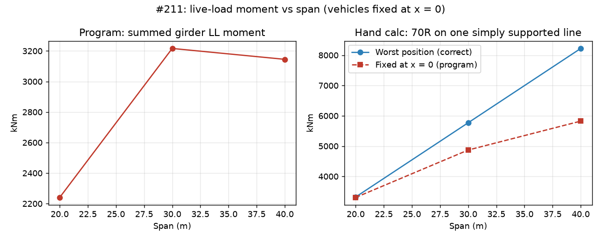

# Proof — #211: Design live load is taken from static vehicles parked at x = 0, so the girder live-load moment is underestimated

**Issue:** https://github.com/Nidhikhare12/OsdagBridge/issues/211  
**Severity:** S1 · High (unconservative engineering result) · **Tier:** T1 confirmed  
**Environment:** OsdagBridge `dev` @ `d74f56d` · macOS 13.6 (Darwin 22.6.0) · conda env `osdagbridge-env` · tested 2026-11-21

## Reproduce
```bash
source ~/miniconda3/etc/profile.d/conda.sh && conda activate osdagbridge-env
cd osdagbridge-testing-report
P=proofs/211_static_vehicles_fixed_at_x0
# 1. Where the static vehicles are placed (run twice, fresh processes)
python $P/scripts/probe_vehicle_positions.py $P/inputs/H_s40_params.json
# 2. Fix proof: same model, static vehicles centred on the span (monkeypatch inside the test only)
python $P/scripts/probe_vehicle_centered_fix.py $P/inputs/H_s40_params.json
python $P/scripts/probe_vehicle_centered_fix.py $P/inputs/H_s40_params.json --patch
# 3. Hand calculations from the program's own IRC 6 axle tables
python $P/scripts/hand_fixed_vehicle.py
python $P/scripts/hand_moving_load.py
# 4. Span series 20/30/40 m (each case in its own subprocess), then extract the table and chart
python $P/scripts/batch_design.py test_cases/generated/s12_cases.json dictionaries/s12
python $P/scripts/extract_evidence.py dictionaries/s12 $P/report_output
```
The scripts use `design_runner.py` (copied into `scripts/`) to build the full input dictionary from the short parameter files in `inputs/`.

## Expected
The design live-load effect is the maximum over vehicle positions along the span. The moving-load cases already run from −vehicle length to span + vehicle length (`analyser.py:1908-1910`). For a fixed set of vehicles, the maximum moment on a simply supported span grows with the span.

## Actual
- Every static vehicle starts at x = 0 (`analyser.py:1641`, applied at `:1834`). On a 40 m span, all point loads lie in x ∈ [0.6, 20.3] m (2 × Class A) and x ∈ [0.81, 13.75] m (1 × 70R).
- `create_governing_ll_load_case()` (`analyser.py:1925`, filter at `:1951`) picks the design LL only from these static cases.

| 40 m span | Current (x = 0) | Vehicles centred (fix proof) | Change |
|---|---|---|---|
| Governing LL max \|Mz_i\| | 1106.3 kNm | 1527.7 kNm | +38 % |
| LL moment per girder | 775–797 kNm | 1362–1389 kNm | +71–79 % |
| Design moment `mu_applied` | 3553.9 kNm | 4137.7 kNm | +16.4 % |

**Hand check** (fixed at x = 0 ÷ worst position, single simply supported line):

| Span | Class A | Class 70R |
|---|---|---|
| 20 m | 0.89 | 1.00 |
| 25 m | 0.90 | 0.92 |
| 30 m | 0.84 | 0.84 |
| 40 m | 0.71 | 0.71 |

**Metamorphic check (program output):** the LL moment summed over the girders is 2240.4 kNm (20 m), 3216.4 kNm (30 m) and **3145.2 kNm (40 m)**. The interior-girder LL moment also falls, from 826.6 kNm (30 m) to 775.5 kNm (40 m). A longer span cannot give less live-load moment from the same vehicles.



## Evidence in this folder
| File | What it shows |
|---|---|
| `logs/probe_vehicle_positions_s40.log`, `logs/probe_vehicle_positions_s40_run2.log` | Two fresh processes: identical vehicle x-ranges and governing LL (1106.32 kNm) |
| `logs/probe_vehicle_centered_fix_s40.log` | Original vs centred vehicles: governing LL, per-girder LL, `mu_applied` |
| `logs/hand_fixed_vehicle.log` | Hand moments, vehicle fixed at x = 0 vs worst position, 20–40 m |
| `logs/hand_moving_load.log` | Hand moving-load maxima (Class A, 2 lanes, 70R) for comparison |
| `logs/span_series_20_30_40.log`, `logs/extract_evidence.log` | Program output for 20/30/40 m spans |
| `report_output/span_series_extract.json` | Per-girder LL moments and `mu_applied` extracted from the saved design states |
| `report_output/span_vs_ll_moment.png` | Chart: program LL moment vs span, and hand calc fixed-at-x=0 vs worst position |
| `inputs/H_s20_params.json`, `H_s30_params.json`, `H_s40_params.json` | Exact inputs (span 20/30/40 m, carriageway 7.5 m, skew 0°, no footpath, no median, Optimized) |

## Root cause
`analyser.py:1641` sets `x_coord = 0.0` for every static vehicle, and `analyser.py:1951` limits the governing-LL search to these static cases (`str(lc).lower().startswith("case")`).

## Notes
The OsdagBridge clone was never modified. The fix was proven by monkeypatching inside `probe_vehicle_centered_fix.py --patch`; only the vehicles' x offset changes. The issue text as posted is in `ISSUE_211.md`.
