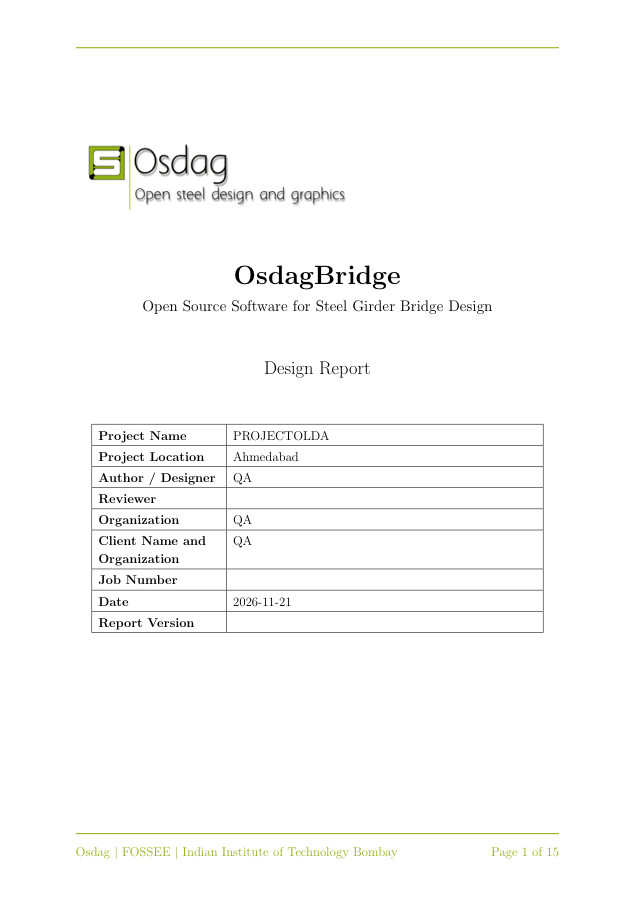

# Proof — #212: generate_report returns an older PDF as the new report when compilation fails

**Issue:** https://github.com/Nidhikhare12/OsdagBridge/issues/212  
**Severity:** S2 · Medium (wrong document delivered as success) · **Tier:** T1 confirmed  
**Environment:** OsdagBridge `dev` @ `d74f56d` · macOS 13.6 (Darwin 22.6.0) · conda env `osdagbridge-env` · tested 2026-11-21

## Reproduce
```bash
source ~/miniconda3/etc/profile.d/conda.sh && conda activate osdagbridge-env
cd osdagbridge-testing-report
python proofs/212_stale_pdf_returned_as_success/scripts/probe_stale_pdf.py evidence/tmp/stale1
python proofs/212_stale_pdf_returned_as_success/scripts/probe_stale_pdf.py evidence/tmp/stale2
```
Each run uses two child processes:
1. Generate a report for project `PROJECTOLDA` normally.
2. Generate a report for `PROJECTNEWB` into the same folder with `pdflatex` removed from `PATH`. This simulates a machine without LaTeX or a failed compile.

## Expected
Step 2 returns `pdf_path=None` and reports an error, or the old PDF is removed before compiling.

## Actual
Step 2 returns `pdf_path='.../bridge_report.pdf'` as success. That PDF is byte-identical to step 1 (same SHA-256 and modification time) and still shows **PROJECTOLDA**. The `.tex` beside it is the new one, with **PROJECTNEWB**. The only sign of failure is a log warning: `pdflatex run failed: [Errno 2] No such file or directory: 'pdflatex'`.

| Run | PDF SHA-256 step 1 | PDF SHA-256 step 2 | Returned as success | .tex project |
|---|---|---|---|---|
| 1 | `6df33cac25769d27…` | `6df33cac25769d27…` (unchanged) | yes | PROJECTNEWB |
| 2 | `01b4777dca2744a2…` | `01b4777dca2744a2…` (unchanged) | yes | PROJECTNEWB |



## Evidence in this folder
| File | What it shows |
|---|---|
| `logs/probe_stale_pdf.log` | Both runs: returned paths, SHA and mtime unchanged, `.tex` has the new name, warning text |
| `report_output/returned_pdf_still_PROJECTOLDA.pdf` | The PDF returned as the "new" report in step 2 (run 1) |
| `report_output/new_tex_PROJECTNEWB.tex` | The `.tex` written in step 2, for the new project |
| `screenshots/returned_pdf_page1_shows_PROJECTOLDA.png` | Title page of the returned PDF: project name is still PROJECTOLDA |
| `scripts/probe_stale_pdf.py`, `scripts/_child_generated.py` | Driver and the child script it generates |

## Root cause
`src/osdagbridge/core/reports/report_generator.py:981-983` judges success by `os.path.exists(pdf_path)` in the output folder. The newly compiled PDF is copied there only if it exists in the temporary folder (`:978-979`), so an old file passes the check.

## Notes
The OsdagBridge clone was never modified. The `PATH` change applies only to the child process. The issue text as posted is in `ISSUE_212.md`.
