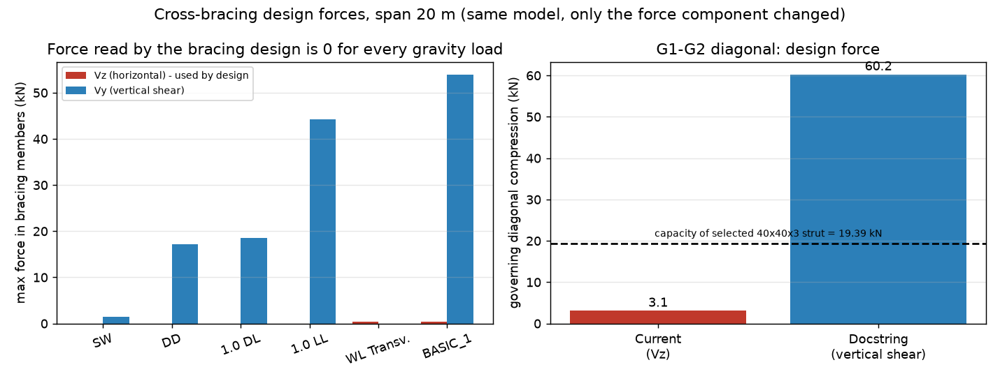
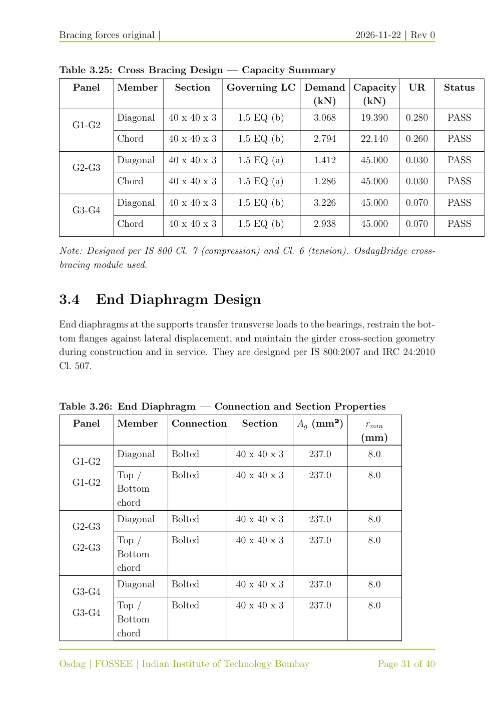
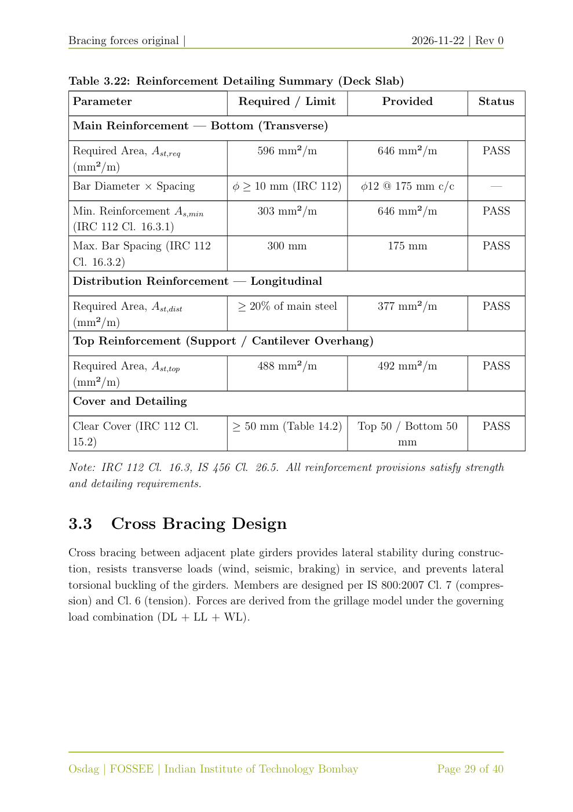
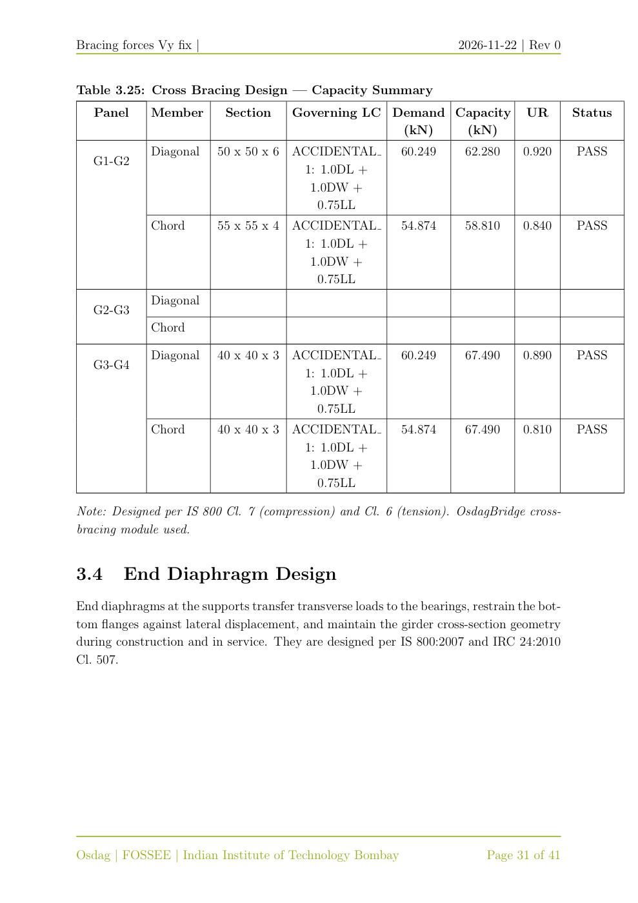

# Proof — #215: Cross-bracing design forces ignore every gravity load

**Issue:** https://github.com/Nidhikhare12/OsdagBridge/issues/215  

**Severity:** S1 candidate (undersized bracing members) · **Tier:** T1 (mechanism reproduced 3×, fix proven)
**Environment:** OsdagBridge `dev` @ `d74f56d` · macOS 13.6 · conda env `osdagbridge-env` · tested 2026-11-22

## Reproduce
```bash
source ~/miniconda3/etc/profile.d/conda.sh && conda activate osdagbridge-env
cd osdagbridge-testing-report
P=proofs/215_bracing_forces_ignore_gravity_loads
python $P/scripts/probe_bracing_vy_vz.py $P/inputs/H_s20_params.json          # Vz vs Vy per load case + design forces
python $P/scripts/probe_bracing_fix.py   $P/inputs/H_s20_params.json          # current design
python $P/scripts/probe_bracing_fix.py   $P/inputs/H_s20_params.json --vy     # fix proof: vertical shear (docstring)
python $P/scripts/proof_bracing_report.py $P/inputs/H_s20_params.json /tmp/br # full PDF report
```

## Key result
| Load case | max \|Vz_i\| (used) | max \|Vy_i\| (vertical) |
|---|---|---|
| 1.0 DL | 0.00 kN | 18.55 kN |
| 1.0 LL | 0.00 kN | 44.28 kN |
| BASIC_1 | 0.35 kN | 53.96 kN |

The governing bracing forces are 0.16–3.23 kN, all from `1.5 EQ` / `WL Transverse`. Using the vertical shear the docstring describes, the G1-G2 diagonal compression is **60.25 kN** against the **19.39 kN** capacity of the selected 40×40×3 strut. The design then selects 50×50×6.



## Screenshots (OsdagBridge's own generated PDF report)
**Current program:** every governing load case is `1.5 EQ`, with demands of 1.4–3.2 kN and all members 40×40×3.



**Same report, text page:** it claims the forces come from "DL + LL + WL".



**After the fix proof** (vertical shear, test-only monkeypatch): the governing case is a gravity combination, the demand is 60.2 kN, and G1-G2 is resized to 50×50×6 / 55×55×4.



## Evidence
| File | What it shows |
|---|---|
| `logs/probe_bracing_vy_vz.log` | Two fresh runs: geometry, design forces, max Vz/Vy per load case (identical) |
| `logs/probe_bracing_fix.log` | Original vs `--vy`: forces, governing LC, selected sections, capacities, efficiencies |
| `report_output/crossbracing_forces_dict.json` | `output_dict["crossbracing_forces_dict"]` of the original run |
| `report_output/bracing_forces_vz_vs_vy.png` | Chart of the two logs |
| `screenshots/report_capacity_summary_forces_from_EQ_only.png` | Generated PDF report: every governing LC is 1.5 EQ; demands 1.4–3.2 kN |
| `screenshots/report_text_claims_DL_LL_WL.png` | Same report: the text says forces come from "DL + LL + WL" |
| `screenshots/report_capacity_summary_AFTER_vy_fix.png` | Report generated with the vertical-shear fix: 60.249 kN, sections resized |
| `report_output/osdagbridge_report_current.pdf`, `osdagbridge_report_with_vy_fix.pdf` | Both full generated reports (cross bracing: pages 29–32) |
| `logs/proof_bracing_report_vy.log` | Run log of the fixed-report generation |
| `inputs/H_s20_params.json` | Exact input |

## Root cause
`crossbracingforces.py:333` reads `Vz_i`. Gravity loads act in y (`analyser.py:1454`), so Vz is 0 for DL/LL. The docstring (`:38`) says the chord force is "the full vertical shear".

## Notes
The clone was never modified. The fix was proven by monkeypatching `CrossBracingForces._read_vz` inside the test only. How much of the vertical shear the bracing (rather than the deck) carries is a modelling question. The finding is that gravity loads contribute exactly zero, contrary to the module's own description and the report text.

The issue text as posted is in `ISSUE_215.md`.
