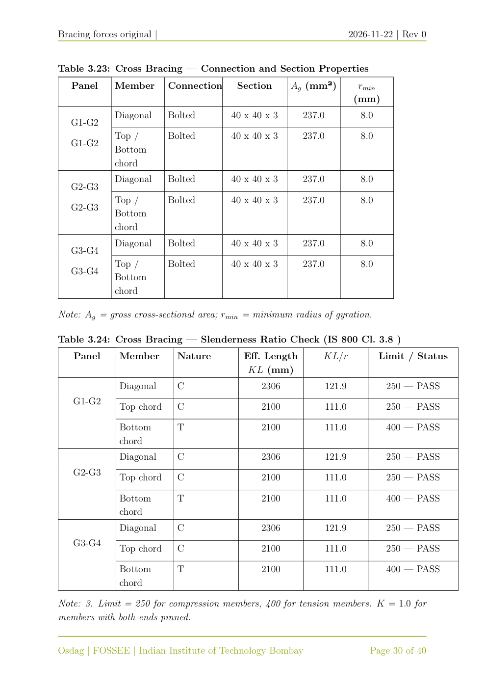
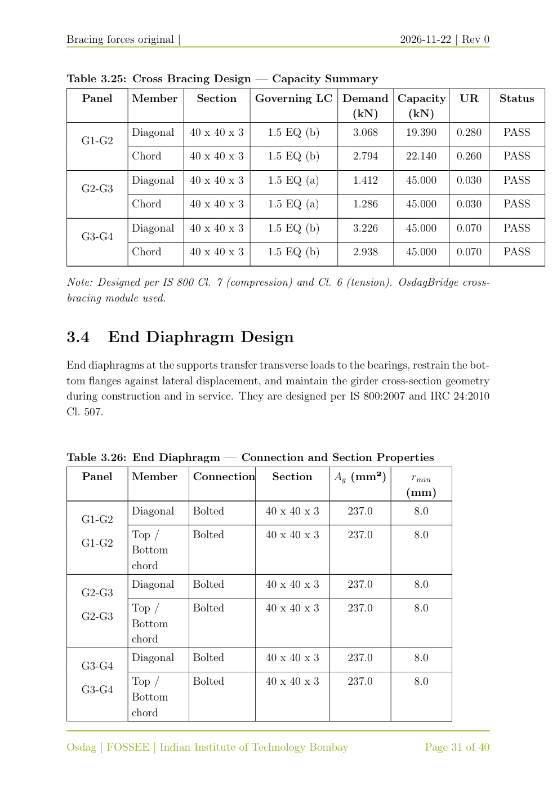

# Proof — #216: Cross-bracing report tables contradict themselves

**Issue:** https://github.com/Nidhikhare12/OsdagBridge/issues/216  

**Severity:** S2 (report shows PASS for a slenderness its own numbers put at 288 > 250) · **Tier:** T1 (two fresh runs, identical chapter)
**Environment:** OsdagBridge `dev` @ `d74f56d` · macOS 13.6 · conda env `osdagbridge-env` · tested 2026-11-22

## Reproduce
```bash
source ~/miniconda3/etc/profile.d/conda.sh && conda activate osdagbridge-env
cd osdagbridge-testing-report
P=proofs/216_bracing_report_tables_contradict
python $P/scripts/proof_bracing_report.py $P/inputs/H_s20_params.json /tmp/br1
python $P/scripts/proof_bracing_report.py $P/inputs/H_s20_params.json /tmp/br2
```

## Key result
| Table | Printed | From the same page |
|---|---|---|
| Slenderness, diagonal | KL 2306 mm, KL/r **121.9 — PASS** | 2306 / r_min 8.0 = **288.3 > 250** |
| Slenderness, top chord | KL 2100 mm, KL/r **111.0 — PASS** | 2100 / 8.0 = **262.5 > 250** |
| Capacity, G1-G2 diagonal | UR **0.280** | 3.068 / 19.390 = **0.158** |
| Capacity, G1-G2 chord | UR **0.260** | 2.794 / 22.140 = **0.126** |




## Evidence
| File | What it shows |
|---|---|
| `report_output/osdagbridge_report_run1.pdf` | Full generated report (cross bracing: pages 29–31 of 40) |
| `report_output/cross_bracing_chapter_run1.tex`, `..._run2.tex` | The chapter's LaTeX from two fresh runs (identical) |
| `screenshots/*.png` | The two tables as rendered |
| `logs/proof_bracing_report_run2.log` | Second run |

## Root cause
`report_generator.py:617-627` (geometric length as KL) is combined with `:580-587` (the design's KL/r) in `chap5.py:751-760`. `chap5.py:788-789` prints the module `efficiency` as UR.

The issue text as posted is in `ISSUE_216.md`.
