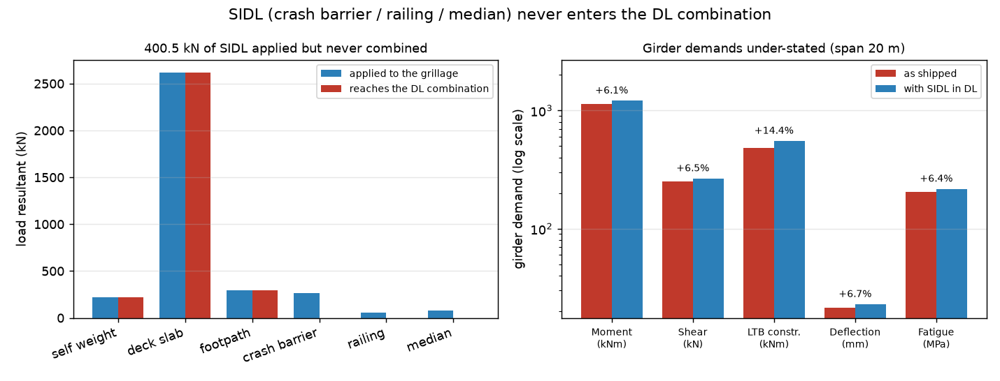
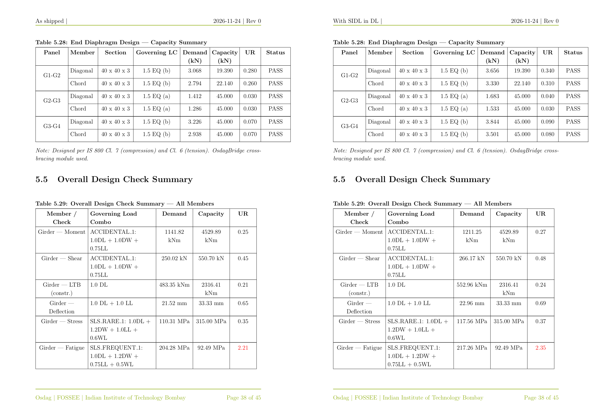

# Proof — #312: Crash barrier, railing and median never enter the DL combination

**Issue:** https://github.com/Nidhikhare12/OsdagBridge/issues/312  

**Severity:** S1 candidate (unconservative: every girder demand under-stated) · **Tier:** T1 (three fresh processes, fix proven)
**Environment:** OsdagBridge `dev` @ `d74f56d` · macOS 13.6 · conda env `osdagbridge-env` · tested 2026-11-24

## Reproduce
```bash
source ~/miniconda3/etc/profile.d/conda.sh && conda activate osdagbridge-env
cd osdagbridge-testing-report
P=proofs/312_sidl_missing_from_dead_load_combination
python $P/scripts/probe_sidl_missing.py $P/inputs/H_s20_params.json            # as shipped
python $P/scripts/probe_sidl_missing.py $P/inputs/H_s20_params.json --fix      # fix proof
python $P/scripts/probe_sidl_missing.py $P/inputs/H_s20_footpath_median_params.json
# full OsdagBridge report, shipped vs fixed
python $P/scripts/proof_report_variant.py $P/inputs/H_s20_params.json /tmp/rep_none none
python $P/scripts/proof_report_variant.py $P/inputs/H_s20_params.json /tmp/rep_sidl sidl
```

## Key result
`create_sidl_combination()` (`analyser.py:1564`) is never called anywhere in the code base, so `sidl_combination` stays `None` and the loop in `create_dead_load_combination()` skips it (`_DL_ATTRS`, `analyser.py:1532-1537`).

| Quantity (span 20 m, no footpath, no median) | As shipped | With SIDL in DL |
|---|---|---|
| `crash_barrier_load_case` resultant | 261.6 kN (applied, unused) | 261.6 kN |
| `sidl_combination` | `None` | 261.6 kN |
| `dead_load_combination` | **1160.4 kN** (= 97.9 + 1062.5 exactly) | **1422.0 kN** |
| `1.0 DL` moment, G1 | 483.348 kNm (= SW + DD exactly) | 553.025 kNm |
| Seismic dead-load mass | 1364.4 kN | 1626.0 kN |

With footpath = Both Sides and median = Yes, the excluded SIDL is **400.5 kN** (crash barrier 261.6 + railing 58.9 + median 80.0).



**OsdagBridge's own report, Overall Design Check Summary — as shipped (left) vs with SIDL in DL (right).** Every girder check is under-stated: moment 1141.82 → 1211.25 kNm, shear 250.02 → 266.17 kN, LTB 483.35 → 552.96 kNm, deflection 21.52 → 22.96 mm, fatigue 204.28 → 217.26 MPa.



## Evidence
| File | What it shows |
|---|---|
| `logs/probe_sidl_missing.log` | Two fresh runs as shipped (identical) plus the fix proof: sub-case resultants, DL total, girder moments, seismic mass |
| `logs/probe_sidl_fp_med.log` | Footpath + median case: 400.5 kN of SIDL excluded |
| `logs/proof_report_variants.log` | Third reproduction through the full report path |
| `report_output/report_as_shipped.pdf`, `report_with_sidl_in_DL.pdf` | Both generated reports (summary on page 38 of 45) |
| `report_output/sidl_load_path_and_demands.png` | Chart of both logs |
| `screenshots/overall_summary_shipped_vs_sidl_fixed.png` | The two summary tables side by side |
| `inputs/*.json` | Exact inputs |

## Root cause
`plategirderbridge.py:1336-1339` creates the crash barrier, railing and median cases and then calls `create_dead_load_combination()` without ever calling `create_sidl_combination()`. Every combination maps `'dead_load' -> 'dead_load_combination'` (`analyser.py:2319`, `:2517`), and the seismic mass uses the same case (`:1040`).

## Notes
The OsdagBridge clone was never modified; the fix was proven by a monkeypatch inside the test that inserts the single missing call. The loads are still applied to the grillage and still appear in the report's quantities (the crash barrier shows as 30.23 MT in the Bill of Materials), which is what hides the omission.

The issue text as posted is in `ISSUE_312.md`.
