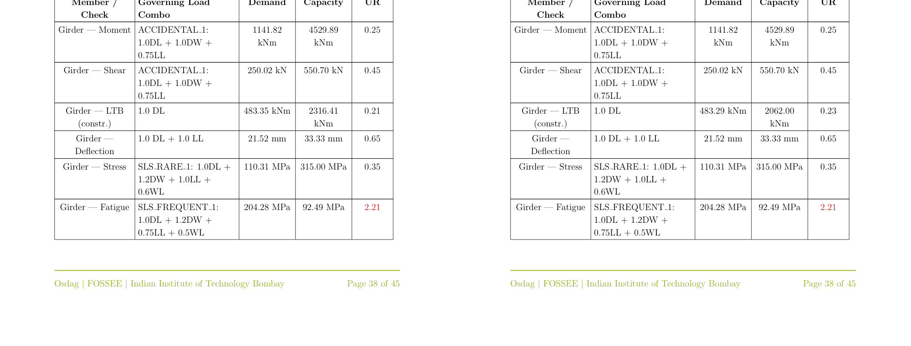

# Proof — #313: beta_b is always 1.0, so Slender girders get the full plastic moment

**Issue:** https://github.com/Nidhikhare12/OsdagBridge/issues/313  

**Severity:** S2 (unconservative LTB capacity, overstated by Zp/Ze = 12.3 %) · **Tier:** T1 (two fresh processes, fix proven)
**Environment:** OsdagBridge `dev` @ `d74f56d` · macOS 13.6 · conda env `osdagbridge-env` · tested 2026-11-24

## Reproduce
```bash
source ~/miniconda3/etc/profile.d/conda.sh && conda activate osdagbridge-env
cd osdagbridge-testing-report
P=proofs/313_beta_b_precedence_plastic_moment
python $P/scripts/probe_beta_b_precedence.py $P/inputs/H_s20_params.json          # as shipped
python $P/scripts/probe_beta_b_precedence.py $P/inputs/H_s20_params.json --fix    # fix proof
python $P/scripts/proof_report_variant.py $P/inputs/H_s20_params.json /tmp/rep_betab betab
```

## Key result
```python
beta_b = 1.0 if section_class == KEY_Plastic or KEY_Compact else Ze/Zp
```
parses as `(section_class == KEY_Plastic) or KEY_Compact`. `KEY_Compact` is the non-empty string `"Compact"`, so the condition is always true and the `Ze/Zp` branch is dead code.

| `section_class` passed | Md returned |
|---|---|
| Plastic / Compact / Semi-Compact / Slender / slender | **2664.22 kNm — identical** |
| correct for this girder (Ze/Zp = 0.8902) | 2371.60 kNm |

The program classifies the tested 20 m girder as **Slender** itself (d/tw = 136.0 against a semi-compact limit of 106.49) and still applies the plastic modulus.

| End to end (span 20 m) | As shipped | β_b corrected |
|---|---|---|
| Implied Mpl (Mb / χ_LT) | 2663.85 kNm | 2371.28 kNm |
| LTB (Girder SW Only) capacity / DCR | 304.75 kNm / 0.1330 | 271.27 kNm / 0.1494 |
| LTB (Construction Stage) capacity / DCR | 2316.41 kNm / 0.2085 | 2062.00 kNm / 0.2343 |

**OsdagBridge's own report, Overall Design Check Summary — as shipped (left) vs β_b corrected (right).** Only the LTB capacity changes: 2316.41 → 2062.00 kNm, UR 0.21 → 0.23.



## Evidence
| File | What it shows |
|---|---|
| `logs/proof_report_variants.log` | Shipped and corrected runs through the full report path |
| `report_output/report_as_shipped.pdf`, `report_with_betab_fixed.pdf` | Both generated reports (summary on page 38 of 45) |
| `screenshots/overall_summary_shipped_vs_betab_fixed.png` | The two summary tables side by side |
| `scripts/probe_beta_b_precedence.py` | Unit-level table plus the end-to-end comparison |
| `inputs/H_s20_params.json` | Exact input |

## Root cause
The line exists in two copies: `osdagbridge/core/utils/codes/is800_2007.py:1026` (bundled) and `osdag_core/utils/common/is800_2007.py:1012` in the `osdag_core` dependency. **The osdag_core copy is the one executed**, because `irc22_2015.py:9-11` prefers it. `irc22_2015.py:649` then returns `chi_LT * Mpl`, so the unreduced value reaches the design check; the correct `beta_b` that IRC22 computes at `:626-628` is used only for `lambda_LT`.

## Notes
In the cases tested both LTB checks pass either way, so no verdict flipped; the finding is that the capacity is systematically overstated by Zp/Ze. A design whose LTB utilisation lies between 0.89 and 1.00 would be reported as PASS when it fails. A side effect is that the section classification the program computes and prints has no influence at all on the bending resistance.

The issue text as posted is in `ISSUE_313.md`.
