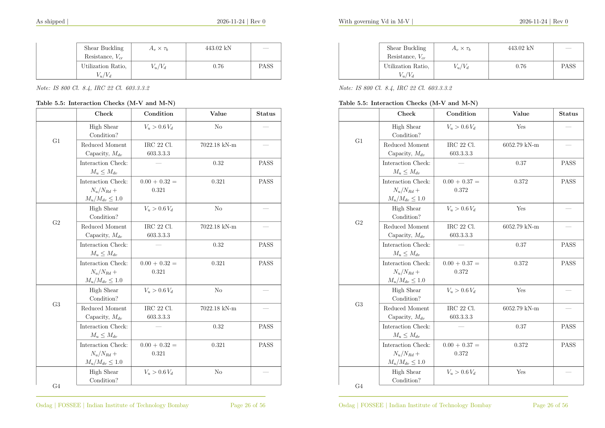

# Proof — #315: M-V interaction uses the plastic shear capacity, so high shear never reduces the moment capacity

**Issue:** https://github.com/Nidhikhare12/OsdagBridge/issues/315  

**Severity:** S2 (unconservative: moment capacity 13.8 % too high in high-shear cases) · **Tier:** T1 (two fresh processes, fix proven)
**Environment:** OsdagBridge `dev` @ `d74f56d` · macOS 13.6 · conda env `osdagbridge-env` · tested 2026-11-24

## Reproduce
```bash
source ~/miniconda3/etc/profile.d/conda.sh && conda activate osdagbridge-env
cd osdagbridge-testing-report
P=proofs/315_mv_interaction_uses_plastic_shear
python $P/scripts/probe_mv_interaction_vd.py $P/inputs/MED_w7.5_params.json         # as shipped
python $P/scripts/probe_mv_interaction_vd.py $P/inputs/MED_w7.5_params.json --fix   # fix proof
python $P/scripts/proof_report_variant.py $P/inputs/MED_w7.5_params.json /tmp/a none
python $P/scripts/proof_report_variant.py $P/inputs/MED_w7.5_params.json /tmp/b mv
```

## Key result
Span 25 m, carriageway 7.5 m, median, Optimized:

| Quantity | As shipped | With the governing `Vd` |
|---|---|---|
| Vu | 334.56 kN | 334.56 kN |
| Vcr (shear buckling, governing) | 443.02 kN | 443.02 kN |
| Vd (plastic) used for the trigger | 1989.86 kN | — |
| High-shear threshold `0.6·Vd` | **1193.9 kN** | 265.8 kN |
| `beta_interaction` | **0.0** | 0.2605 |
| M-V capacity | **7022.18 kNm** | 6052.79 kNm |
| DCR (Mu = 2235.12 kNm) | 0.3183 | 0.3693 |

Hand check (IS 800 Cl. 9.2.2): Mfd = 3300.3 kNm, beta = (2×334.56/443.02 − 1)² = 0.2605,
Mdv = 7022.18 − 0.2605 × (7022.18 − 3300.3) = **6052.8 kNm** — matches the patched run exactly.

**OsdagBridge's own report, page 26 — as shipped (left) vs governing Vd (right).** The same page prints the shear utilisation `Vu/Vd = 0.76 PASS` and, directly below it, `High Shear Condition? Vu > 0.6 Vd → No`.



## Scope
Not a corner case: in a routine sweep of 20 designs (spans 20–40 m, carriageway 4.25–7.50 m), **6** fall in the window `0.6·Vcr < Vu < 0.6·Vd` where the reduction is skipped — see `report_output/sweep_high_shear_window.csv`.

## Evidence
| File | What it shows |
|---|---|
| `logs/probe_mv_interaction_vd.log` | Two fresh runs as shipped (identical) plus the fix proof |
| `logs/proof_report_mv.log` | Both report generations |
| `report_output/sweep_high_shear_window.csv` | All 20 designs with Vu, Vcr, Vd and whether the reduction is missed |
| `report_output/report_as_shipped.pdf`, `report_with_governing_Vd.pdf` | Full reports (interaction table on page 26 of 56) |
| `screenshots/interaction_table_shipped_vs_governing_Vd.png` | The two tables side by side |

## Root cause
`designer.py:1826` passes `results.Vd_kN` (plastic, from `:1762`) instead of the governing design shear strength; `results.Vcr_kN` (`:1785`) is what the shear check and the report use as the capacity.

## Notes
The clone was never modified; the fix was proven by a monkeypatch that clamps `Vd` to `min(Vd, Vcr)` at the interaction call. In this case the moment utilisation is low enough that both checks still pass, so no verdict flipped; the finding is the 13.8 % overstated capacity and the contradictory "High Shear Condition? No".

The issue text as posted is in `ISSUE_315.md`.
