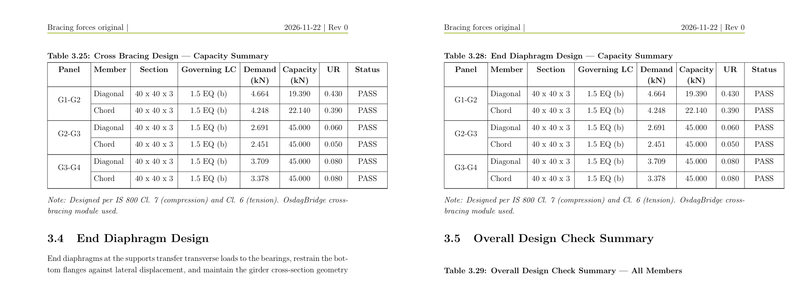
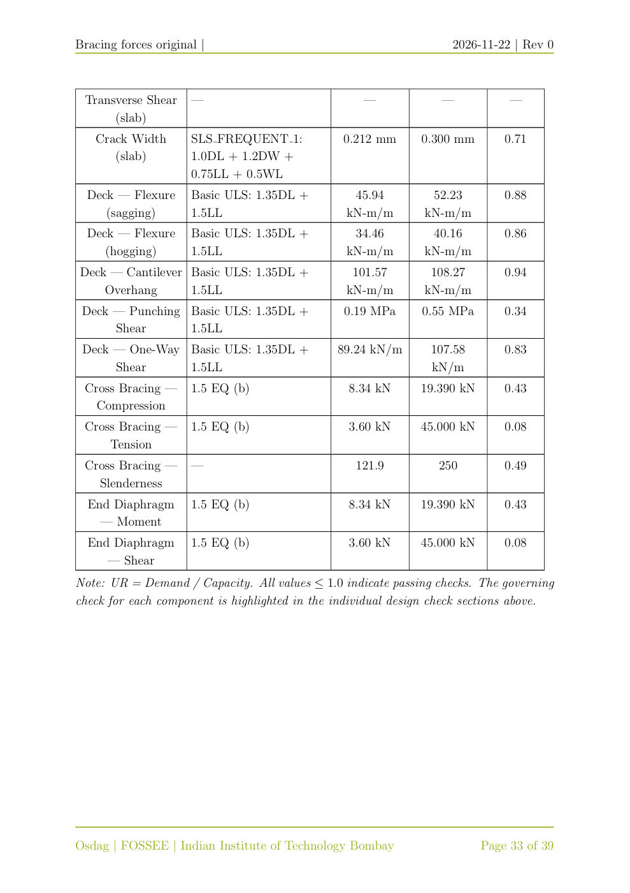

# Proof — NEW (draft 40): The report's End Diaphragm chapter reprints the cross-bracing tables

**Severity:** S2 (report shows PASS results that do not belong to the end diaphragm; at skew 0° none was designed) · **Tier:** T1
**Environment:** OsdagBridge `dev` @ `d74f56d` · macOS 13.6 · conda env `osdagbridge-env` · tested 2026-11-22

## Reproduce
```bash
source ~/miniconda3/etc/profile.d/conda.sh && conda activate osdagbridge-env
cd osdagbridge-testing-report
P=proofs/NEW_end_diaphragm_report_prints_cross_bracing
python $P/scripts/probe_end_diaphragm.py $P/inputs/H_s20_params.json            # skew 0: nothing designed
python $P/scripts/probe_end_diaphragm.py $P/inputs/H_s20_skew10_params.json     # skew 10: own forces
python $P/scripts/proof_bracing_report.py $P/inputs/H_s20_skew10_params.json /tmp/ed10   # full report
```

## Key result
| Case | End-diaphragm design (own) | Report "End Diaphragm" tables |
|---|---|---|
| Skew 0° | all forces `None`; `{'G1-G2': [], 'G2-G3': [], 'G3-G4': []}` | 40×40×3, 3.068 kN, UR 0.280, **PASS** (= cross bracing) |
| Skew 10° | G1-G2 diagonal compression **6.684 kN** | G1-G2 diagonal **4.664 kN** (= cross bracing) |

At the supports, |Vz| = 0 and |Vy| = 69.0 kN (DL) / 63.1 kN (LL), so the Vz-based end-diaphragm force is always 0 for gravity loads.

**Left: Cross Bracing capacity summary. Right: End Diaphragm capacity summary (same report, skew 10°). They are identical.**



**Overall Design Check Summary:** "End Diaphragm — Moment / Shear" rows hold the bracing axial forces in kN.



## Evidence
| File | What it shows |
|---|---|
| `logs/probe_end_diaphragm.log` | Skew 0°, two fresh runs: empty designs, element mapping, Vz/Vy at the supports |
| `logs/probe_end_diaphragm_k10.log` | Skew 10°: the end diaphragm's own forces (6.684 kN etc.) |
| `logs/compare_report_chapters.log` | Three reports: End Diaphragm table rows identical to Cross Bracing (21/21) |
| `report_output/end_diaphragm_chapter_*.tex` | End Diaphragm chapter LaTeX from each report |
| `report_output/osdagbridge_report_skew10.pdf` | Full generated report (pages 30–34) |
| `screenshots/*.png` | Rendered tables |

## Root cause
`chap5.py:1464/1474/1485` insert `cb_forces_content`, `cb_slenderness_content` and `cb_capacity_content` into the End Diaphragm section. `plategirderbridge.py:2728` reads `Vz_i` (same root cause as #215).
